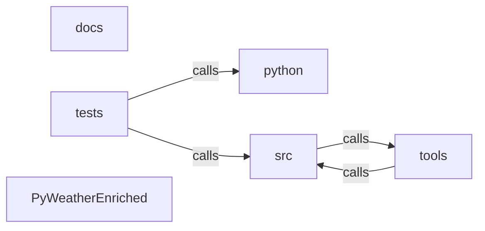

_Generated by CodeAtlas._

## Details

Architecture map of PyWeatherEnriched.

### docs

Owns 0 symbols across 0 file(s).

**Related Classes/Methods:** _None_

### python

Owns 0 symbols across 0 file(s).

**Related Classes/Methods:** _None_

### src

Owns 286 symbols across 15 file(s).

**Related Classes/Methods:** _None_

**Source Files:**

- `src/batch_resolver.rs`
  - `src.batch_resolver.BatchResolutionResult`
  - `src.batch_resolver.BatchResolver`
  - `src.batch_resolver.BatchResolver.cache_size`
  - `src.batch_resolver.BatchResolver.clear_cache`
  - `src.batch_resolver.BatchResolver.get_deduplication_stats`
  - `src.batch_resolver.BatchResolver.new`
  - `src.batch_resolver.BatchResolver.resolve_batch`
  - `src.batch_resolver.DeduplicationStats`
  - `src.batch_resolver.LocationKey`
  - `src.batch_resolver.tests.test_batch_resolver_cache`
  - `src.batch_resolver.tests.test_batch_resolver_dedup`
  - `src.batch_resolver.tests.test_deduplication_stats`
- `src/cache.rs`
  - `src.cache.Cache`
  - `src.cache.Cache.clear`
  - `src.cache.Cache.get`
  - `src.cache.Cache.is_empty`
  - `src.cache.Cache.len`
  - `src.cache.Cache.new`
  - `src.cache.Cache.put`
  - `src.cache.tests.sample`
  - `src.cache.tests.test_clear_empties_cache`
  - `src.cache.tests.test_evicts_least_recently_used_at_capacity`
  - `src.cache.tests.test_miss_returns_none`
  - `src.cache.tests.test_put_then_get_round_trips`
- `src/cloud_storage.rs`
  - `src.cloud_storage.AwsRedshiftWriter`
  - `src.cloud_storage.AwsRedshiftWriter.create_table_if_not_exists`
  - `src.cloud_storage.AwsRedshiftWriter.get_row_count`
  - `src.cloud_storage.AwsRedshiftWriter.new`
  - `src.cloud_storage.AwsRedshiftWriter.write_enriched_records`
  - `src.cloud_storage.AwsS3Adapter`
  - `src.cloud_storage.AwsS3Adapter.download_enriched_data`
  - `src.cloud_storage.AwsS3Adapter.list_objects`
  - `src.cloud_storage.AwsS3Adapter.new`
  - `src.cloud_storage.AwsS3Adapter.upload_enriched_data`
  - `src.cloud_storage.AzureBlobLocation`
  - `src.cloud_storage.AzureBlobStorageAdapter`
  - `src.cloud_storage.AzureBlobStorageAdapter.download_from_blob`
  - `src.cloud_storage.AzureBlobStorageAdapter.new`
  - `src.cloud_storage.AzureBlobStorageAdapter.upload_to_blob`
  - `src.cloud_storage.AzureSynapseWriter`
  - `src.cloud_storage.AzureSynapseWriter.create_external_table`
  - `src.cloud_storage.AzureSynapseWriter.new`
  - `src.cloud_storage.AzureSynapseWriter.write_enriched_data`
  - `src.cloud_storage.BigQueryConfig`
  - `src.cloud_storage.CloudProvider`
  - `src.cloud_storage.CloudStorageConfig`
  - `src.cloud_storage.Credentials`
  - `src.cloud_storage.GcsLocation`
  - `src.cloud_storage.GoogleBigQueryWriter`
  - `src.cloud_storage.GoogleBigQueryWriter.insert_enriched_data`
  - `src.cloud_storage.GoogleBigQueryWriter.new`
  - `src.cloud_storage.GoogleBigQueryWriter.query`
  - `src.cloud_storage.GoogleCloudStorageAdapter`
  - `src.cloud_storage.GoogleCloudStorageAdapter.download_from_gcs`
  - `src.cloud_storage.GoogleCloudStorageAdapter.new`
  - `src.cloud_storage.GoogleCloudStorageAdapter.upload_to_gcs`
  - `src.cloud_storage.RedshiftConfig`
  - `src.cloud_storage.S3Location`
  - `src.cloud_storage.SynapseConfig`
  - `src.cloud_storage.tests.test_azure_blob_location`
  - `src.cloud_storage.tests.test_bigquery_config`
  - `src.cloud_storage.tests.test_cloud_provider_enum`
  - `src.cloud_storage.tests.test_gcs_location`
  - `src.cloud_storage.tests.test_redshift_config`
  - `src.cloud_storage.tests.test_s3_location`
  - `src.cloud_storage.tests.test_synapse_config`
- `src/database.rs`
  - `src.database.ConnectionStats`
  - `src.database.DatabaseConfig`
  - `src.database.DatabasePool`
  - `src.database.DatabasePool.add_writer`
  - `src.database.DatabasePool.close_all`
  - `src.database.DatabasePool.new`
  - `src.database.DatabasePool.write_batch`
  - `src.database.DatabaseType`
  - `src.database.DatabaseWriter`
  - `src.database.EnrichedRecord`
  - `src.database.PostgreSQLWriter`
  - `src.database.PostgreSQLWriter.close`
  - `src.database.PostgreSQLWriter.connect`
  - `src.database.PostgreSQLWriter.create_table_if_not_exists`
  - `src.database.PostgreSQLWriter.get_connection_stats`
  - `src.database.PostgreSQLWriter.new`
  - `src.database.PostgreSQLWriter.write_batch`
  - `src.database.PostgreSQLWriter.write_record`
  - `src.database.SnowflakeConfig`
  - `src.database.SnowflakeWriter`
  - `src.database.SnowflakeWriter.close`
  - `src.database.SnowflakeWriter.connect`
  - `src.database.SnowflakeWriter.create_table_if_not_exists`
  - `src.database.SnowflakeWriter.get_connection_stats`
  - `src.database.SnowflakeWriter.new`
  - `src.database.SnowflakeWriter.write_batch`
  - `src.database.SnowflakeWriter.write_record`
  - `src.database.tests.test_connection_stats`
  - `src.database.tests.test_database_config_new`
  - `src.database.tests.test_enriched_record`
  - `src.database.tests.test_postgresql_writer`
- `src/distributed_processing.rs`
  - `src.distributed_processing.CompressionType`
  - `src.distributed_processing.DistributedEnrichmentPipeline`
  - `src.distributed_processing.DuckDBConfig`
  - `src.distributed_processing.DuckDBEnricher`
  - `src.distributed_processing.DuckDBEnricher.load_csv`
  - `src.distributed_processing.DuckDBEnricher.load_parquet`
  - `src.distributed_processing.DuckDBEnricher.new`
  - `src.distributed_processing.DuckDBEnricher.query_and_enrich`
  - `src.distributed_processing.EnrichmentResult`
  - `src.distributed_processing.EnrichmentResult.throughput`
  - `src.distributed_processing.FlinkEnrichmentConfig`
  - `src.distributed_processing.OutputFormat`
  - `src.distributed_processing.PolarsConfig`
  - `src.distributed_processing.PolarsEnricher`
  - `src.distributed_processing.PolarsEnricher.enrich_with_gpu`
  - `src.distributed_processing.PolarsEnricher.enrich_with_lazy_eval`
  - `src.distributed_processing.PolarsEnricher.new`
  - `src.distributed_processing.ProcessingFramework`
  - `src.distributed_processing.PyFlinkEnricher`
  - `src.distributed_processing.PyFlinkEnricher.enable_exactly_once_semantics`
  - `src.distributed_processing.PyFlinkEnricher.new`
  - `src.distributed_processing.PyFlinkEnricher.stream_enrich`
  - `src.distributed_processing.PySparkEnricher`
  - `src.distributed_processing.PySparkEnricher.enrich_dataset`
  - `src.distributed_processing.PySparkEnricher.new`
  - `src.distributed_processing.PySparkEnricher.write_to_delta_lake`
  - `src.distributed_processing.PySparkEnricher.write_to_iceberg`
  - `src.distributed_processing.SparkEnrichmentConfig`
  - `src.distributed_processing.StreamResult`
  - `src.distributed_processing.tests.test_compression_types`
  - `src.distributed_processing.tests.test_duckdb_config`
  - `src.distributed_processing.tests.test_enrichment_result_throughput`
  - `src.distributed_processing.tests.test_flink_config`
  - `src.distributed_processing.tests.test_output_formats`
  - `src.distributed_processing.tests.test_polars_config`
  - `src.distributed_processing.tests.test_spark_config`
  - `src.distributed_processing.tests.test_stream_result`
- `src/enhanced_cache.rs`
  - `src.enhanced_cache.CacheEntry`
  - `src.enhanced_cache.CacheEntry.is_expired`
  - `src.enhanced_cache.CacheKey`
  - `src.enhanced_cache.CacheStats`
  - `src.enhanced_cache.DateRange`
  - `src.enhanced_cache.DateRange.contains`
  - `src.enhanced_cache.DateRange.new`
  - `src.enhanced_cache.DateRange.overlaps`
  - `src.enhanced_cache.EnhancedCache`
  - `src.enhanced_cache.EnhancedCache.cleanup_expired`
  - `src.enhanced_cache.EnhancedCache.deduplicate_batch`
  - `src.enhanced_cache.EnhancedCache.find_nearby_cached`
  - `src.enhanced_cache.EnhancedCache.find_nearby_in_db`
  - `src.enhanced_cache.EnhancedCache.get`
  - `src.enhanced_cache.EnhancedCache.get_from_db`
  - `src.enhanced_cache.EnhancedCache.get_range`
  - `src.enhanced_cache.EnhancedCache.new`
  - `src.enhanced_cache.EnhancedCache.put`
  - `src.enhanced_cache.EnhancedCache.put_to_db`
  - `src.enhanced_cache.EnhancedCache.query_range_from_db`
  - `src.enhanced_cache.EnhancedCache.set_proximity_radius`
  - `src.enhanced_cache.EnhancedCache.set_ttl`
  - `src.enhanced_cache.EnhancedCache.stats`
  - `src.enhanced_cache.EnhancedCache.with_persistence`
  - `src.enhanced_cache.LocationProximity`
  - `src.enhanced_cache.LocationProximity.distance_to`
  - `src.enhanced_cache.LocationProximity.is_nearby`
  - `src.enhanced_cache.LocationProximity.new`
- `src/enricher.rs`
  - `src.enricher.ArchiveResponse`
  - `src.enricher.HourlyData`
  - `src.enricher.WeatherEnricher`
  - `src.enricher.WeatherEnricher.cache_stats`
  - `src.enricher.WeatherEnricher.enrich`
  - `src.enricher.WeatherEnricher.enrich_range`
  - `src.enricher.WeatherEnricher.new`
  - `src.enricher.WeatherEnricher.with_urls`
  - `src.enricher.condition_from_wmo_code`
  - `src.enricher.nearest_hour_index`
  - `src.enricher.parse_timestamp`
  - `src.enricher.tests.enricher_with_mock`
  - `src.enricher.tests.test_enrich_caches_repeated_lookups`
  - `src.enricher.tests.test_enrich_range_fetches_whole_range_in_one_request`
  - `src.enricher.tests.test_enrich_range_rejects_start_after_end`
  - `src.enricher.tests.test_enrich_range_skips_null_observations_instead_of_fabricating`
  - `src.enricher.tests.test_enrich_returns_real_parsed_weather`
  - `src.enricher.tests.test_nearest_hour_index_picks_closest`
  - `src.enricher.tests.test_parse_timestamp_accepts_common_formats`
  - `src.enricher.tests.test_wmo_code_mapping_is_real_not_arbitrary`
- `src/geocoder.rs`
  - `src.geocoder.Geocoder`
  - `src.geocoder.Geocoder.default`
  - `src.geocoder.Geocoder.geocode`
  - `src.geocoder.Geocoder.new`
  - `src.geocoder.Geocoder.with_base_url`
  - `src.geocoder.NominatimResult`
  - `src.geocoder.tests.test_geocode_caches_repeated_lookups`
  - `src.geocoder.tests.test_geocode_returns_real_parsed_coordinates`
  - `src.geocoder.tests.test_geocode_unresolvable_location_is_a_real_error`
  - `src.geocoder.tests.test_user_agent_tracks_crate_version`
- `src/geospatial_connectors.rs`
  - `src.geospatial_connectors.ArcGisConnector`
  - `src.geospatial_connectors.ArcGisConnector.fetch_elevation`
  - `src.geospatial_connectors.ArcGisConnector.fetch_hydrography`
  - `src.geospatial_connectors.ArcGisConnector.fetch_land_use`
  - `src.geospatial_connectors.ArcGisConnector.get_profile`
  - `src.geospatial_connectors.ArcGisConnector.new`
  - `src.geospatial_connectors.ArcGisProfile`
  - `src.geospatial_connectors.BufferAnalysis`
  - `src.geospatial_connectors.CartoConnector`
  - `src.geospatial_connectors.CartoConnector.fetch_demographics`
  - `src.geospatial_connectors.CartoConnector.fetch_real_estate`
  - `src.geospatial_connectors.CartoConnector.fetch_urban_metrics`
  - `src.geospatial_connectors.CartoConnector.get_profile`
  - `src.geospatial_connectors.CartoConnector.new`
  - `src.geospatial_connectors.CartoProfile`
  - `src.geospatial_connectors.Demographics`
  - `src.geospatial_connectors.ElevationData`
  - `src.geospatial_connectors.GeoLocation`
  - `src.geospatial_connectors.HydrographyData`
  - `src.geospatial_connectors.LandUseData`
  - `src.geospatial_connectors.PointOfInterest`
  - `src.geospatial_connectors.PostGisConnector`
  - `src.geospatial_connectors.PostGisConnector.analyze_buffer`
  - `src.geospatial_connectors.PostGisConnector.calculate_spatial_index`
  - `src.geospatial_connectors.PostGisConnector.find_nearest_poi`
  - `src.geospatial_connectors.PostGisConnector.get_profile`
  - `src.geospatial_connectors.PostGisConnector.new`
  - `src.geospatial_connectors.PostGisProfile`
  - `src.geospatial_connectors.RealEstateMetrics`
  - `src.geospatial_connectors.SpatialIndex`
  - `src.geospatial_connectors.UrbanMetrics`
  - `src.geospatial_connectors.tests.test_arcgis_connector_creation`
  - `src.geospatial_connectors.tests.test_buffer_analysis`
  - `src.geospatial_connectors.tests.test_carto_connector_creation`
  - `src.geospatial_connectors.tests.test_demographics`
  - `src.geospatial_connectors.tests.test_geo_location`
  - `src.geospatial_connectors.tests.test_postgis_connector_creation`
  - `src.geospatial_connectors.tests.test_spatial_index`
- `src/http_retry.rs`
  - `src.http_retry.backoff_delay`
  - `src.http_retry.jitter_ms`
  - `src.http_retry.retry_after_delay`
  - `src.http_retry.send_with_retry`
  - `src.http_retry.tests.test_does_not_retry_on_4xx_other_than_429`
  - `src.http_retry.tests.test_gives_up_after_max_retries_on_persistent_5xx`
  - `src.http_retry.tests.test_retries_on_429_then_succeeds`
  - `src.http_retry.tests.test_succeeds_immediately_on_200`
- `src/lib.rs`
  - `src.lib.PyCacheStats`
  - `src.lib.PyCacheStats.__repr__`
  - `src.lib.PyCacheStats.hit_ratio`
  - `src.lib.PyEnhancedCache`
  - `src.lib.PyEnhancedCache.cleanup_expired`
  - `src.lib.PyEnhancedCache.deduplicate_batch`
  - `src.lib.PyEnhancedCache.get`
  - `src.lib.PyEnhancedCache.get_range`
  - `src.lib.PyEnhancedCache.new`
  - `src.lib.PyEnhancedCache.put`
  - `src.lib.PyEnhancedCache.set_proximity_radius`
  - `src.lib.PyEnhancedCache.set_ttl`
  - `src.lib.PyEnhancedCache.stats`
  - `src.lib.PyEnrichedRow`
  - `src.lib.PyEnrichedRow.__repr__`
  - `src.lib.PyEnrichedRow.new`
  - `src.lib.PyWeatherEnricher`
  - `src.lib.PyWeatherEnricher.cache_stats`
  - `src.lib.PyWeatherEnricher.enrich_batch`
  - `src.lib.PyWeatherEnricher.enrich_range`
  - `src.lib.PyWeatherEnricher.enrich_row`
  - `src.lib.PyWeatherEnricher.new`
  - `src.lib._pyweatherenriched`
- `src/parallel.rs`
  - `src.parallel.ParallelEnricher`
  - `src.parallel.ParallelEnricher.enrich_batch`
  - `src.parallel.ParallelEnricher.enrich_batch_locations`
  - `src.parallel.ParallelEnricher.new`
  - `src.parallel.tests.test_parallel_enrich_batch`
- `src/python_bindings.rs`
  - `src.python_bindings.EnrichmentBuilder`
  - `src.python_bindings.EnrichmentBuilder.__repr__`
  - `src.python_bindings.EnrichmentBuilder.build`
  - `src.python_bindings.EnrichmentBuilder.new`
  - `src.python_bindings.EnrichmentBuilder.with_cache_size`
  - `src.python_bindings.tests.test_defaults_and_with_cache_size_are_immutable_builder_steps`
- `src/streaming_io.rs`
  - `src.streaming_io.DataRow`
  - `src.streaming_io.StreamingReader`
  - `src.streaming_io.StreamingReader.new`
  - `src.streaming_io.StreamingReader.read_csv_batches`
  - `src.streaming_io.StreamingReader.read_json_batches`
  - `src.streaming_io.StreamingStats`
  - `src.streaming_io.StreamingWriter`
  - `src.streaming_io.StreamingWriter.new`
  - `src.streaming_io.StreamingWriter.write_csv_batches`
  - `src.streaming_io.StreamingWriter.write_json_lines`
  - `src.streaming_io.tests.test_data_row`
  - `src.streaming_io.tests.test_streaming_reader_new`
  - `src.streaming_io.tests.test_streaming_writer_new`
- `src/types.rs`
  - `src.types.EnrichedData`

### tests

Owns 53 symbols across 3 file(s).

**Related Classes/Methods:** _None_

**Source Files:**

- `tests/test_codeatlas_adapter.py`
  - `tests.test_codeatlas_adapter._run`
  - `tests.test_codeatlas_adapter.test_check_reports_the_embedded_engine_available`
  - `tests.test_codeatlas_adapter.test_diagnose_summarises_the_architecture_map`
  - `tests.test_codeatlas_adapter.test_explain_reports_an_unknown_node_as_an_error`
  - `tests.test_codeatlas_adapter.test_god_nodes_are_ranked_by_degree`
- `tests/test_features.py`
  - `tests.test_features.TestAddAnomalyFeatures`
  - `tests.test_features.TestAddAnomalyFeatures.test_constant_series_has_no_anomaly`
  - `tests.test_features.TestAddAnomalyFeatures.test_expanding_first_row_is_nan_not_divide_by_zero_error`
  - `tests.test_features.TestAddAnomalyFeatures.test_groups_do_not_leak_into_each_others_baseline`
  - `tests.test_features.TestAddAnomalyFeatures.test_obvious_spike_has_large_zscore`
  - `tests.test_features.TestAddAnomalyFeatures.test_rolling_baseline_requires_window`
  - `tests.test_features.TestAddCyclicalTimeFeatures`
  - `tests.test_features.TestAddCyclicalTimeFeatures.test_midnight_and_almost_midnight_are_close_on_the_circle`
  - `tests.test_features.TestAddCyclicalTimeFeatures.test_noon_and_midnight_are_opposite_on_hour_circle`
  - `tests.test_features.TestAddCyclicalTimeFeatures.test_unit_circle_bounds`
  - `tests.test_features.TestAddDegreeDays`
  - `tests.test_features.TestAddDegreeDays.test_custom_base_temp`
  - `tests.test_features.TestAddDegreeDays.test_hdd_and_cdd_are_mutually_exclusive_and_correct`
  - `tests.test_features.TestAddDegreeDays.test_never_negative`
  - `tests.test_features.TestAddRollingFeatures`
  - `tests.test_features.TestAddRollingFeatures.test_missing_column_raises_key_error`
  - `tests.test_features.TestAddRollingFeatures.test_rolling_mean_matches_pandas_directly`
  - `tests.test_features.TestAddRollingFeatures.test_rolling_respects_groups_independently`
  - `tests.test_features.TestAddRollingFeatures.test_unknown_stat_raises`
  - `tests.test_features.TestBuildFeaturesPipeline`
  - `tests.test_features.TestBuildFeaturesPipeline.test_pipeline_adds_all_expected_columns`
  - `tests.test_features.TestEnrichDataframe`
  - `tests.test_features.TestEnrichDataframe.test_missing_location_column_raises`
  - `tests.test_features.TestEnrichDataframe.test_missing_location_column_raises._StubEnricher`
  - `tests.test_features.TestEnrichDataframe.test_missing_location_column_raises._StubEnricher.enrich_batch`
  - `tests.test_features.TestEnrichDataframe.test_uses_enrich_batch_and_aligns_columns_by_row`
  - `tests.test_features.TestEnrichDataframe.test_uses_enrich_batch_and_aligns_columns_by_row._StubEnricher`
  - `tests.test_features.TestEnrichDataframe.test_uses_enrich_batch_and_aligns_columns_by_row._StubEnricher.enrich_batch`
- `tests/test_python_bindings.py`
  - `tests.test_python_bindings.TestCacheStats`
  - `tests.test_python_bindings.TestCacheStats.test_repr_and_hit_ratio`
  - `tests.test_python_bindings.TestEnhancedCache`
  - `tests.test_python_bindings.TestEnhancedCache.test_deduplicate_batch`
  - `tests.test_python_bindings.TestEnhancedCache.test_get_range_rejects_invalid_timestamps`
  - `tests.test_python_bindings.TestEnhancedCache.test_get_range_returns_entries_within_the_window`
  - `tests.test_python_bindings.TestEnhancedCache.test_get_range_without_persistence_returns_empty`
  - `tests.test_python_bindings.TestEnhancedCache.test_miss_returns_none`
  - `tests.test_python_bindings.TestEnhancedCache.test_put_then_get_round_trips`
  - `tests.test_python_bindings.TestEnhancedCache.test_stats_track_hits_and_misses`
  - `tests.test_python_bindings.TestEnhancedCache.test_ttl_and_proximity_are_configurable`
  - `tests.test_python_bindings.TestEnrichedRow`
  - `tests.test_python_bindings.TestEnrichedRow.test_constructs_and_exposes_all_fields`
  - `tests.test_python_bindings.TestWeatherEnricherLive`
  - `tests.test_python_bindings.TestWeatherEnricherLive.test_cache_stats_reflect_repeated_lookups`
  - `tests.test_python_bindings.TestWeatherEnricherLive.test_enrich_batch_processes_multiple_rows`
  - `tests.test_python_bindings.TestWeatherEnricherLive.test_enrich_row_returns_real_data_for_a_real_city`
  - `tests.test_python_bindings.TestWeatherEnricherLive.test_enrichment_builder_produces_a_working_enricher`
  - `tests.test_python_bindings.TestWeatherEnricherLive.test_unresolvable_location_does_not_crash_the_batch`
  - `tests.test_python_bindings._network_available`

### tools

Owns 0 symbols across 0 file(s).

**Related Classes/Methods:** _None_

### PyWeatherEnriched

Owns 0 symbols across 12 file(s).

**Related Classes/Methods:** _None_
