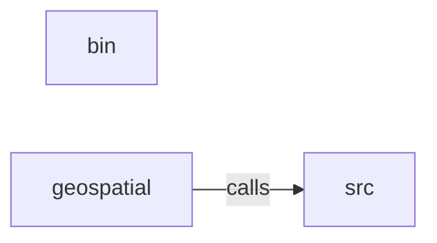

_Generated by CodeAtlas._

## Details

Owns 286 symbols across 15 file(s).

### bin

Owns 2 symbols across 1 file(s).

**Related Classes/Methods:** _None_

**Source Files:**

- `src/bin/validate.rs`
  - `src.bin.validate.Args`
  - `src.bin.validate.main`

### geospatial

Owns 123 symbols across 7 file(s).

**Related Classes/Methods:** _None_

**Source Files:**

- `src/geospatial/config.rs`
  - `src.geospatial.config.DataSource`
  - `src.geospatial.config.DataSourceConfig`
  - `src.geospatial.config.GeospatialConfig`
  - `src.geospatial.config.GeospatialConfig.default_local`
  - `src.geospatial.config.GeospatialConfig.from_file`
  - `src.geospatial.config.GeospatialConfig.hybrid`
  - `src.geospatial.config.GeospatialConfig.with_redis`
  - `src.geospatial.config.GeospatialConfig.with_s3`
- `src/geospatial/data_source.rs`
  - `src.geospatial.data_source.GeoDataLoader`
  - `src.geospatial.data_source.HttpLoader`
  - `src.geospatial.data_source.HttpLoader.format_url`
  - `src.geospatial.data_source.HttpLoader.get_tile`
  - `src.geospatial.data_source.HttpLoader.get_vector`
  - `src.geospatial.data_source.HttpLoader.new`
  - `src.geospatial.data_source.HttpLoader.preload`
  - `src.geospatial.data_source.HybridLoader`
  - `src.geospatial.data_source.HybridLoader.get_tile`
  - `src.geospatial.data_source.HybridLoader.get_vector`
  - `src.geospatial.data_source.HybridLoader.new`
  - `src.geospatial.data_source.HybridLoader.preload`
  - `src.geospatial.data_source.LocalFileLoader`
  - `src.geospatial.data_source.LocalFileLoader.format_path`
  - `src.geospatial.data_source.LocalFileLoader.get_tile`
  - `src.geospatial.data_source.LocalFileLoader.get_vector`
  - `src.geospatial.data_source.LocalFileLoader.new`
  - `src.geospatial.data_source.LocalFileLoader.preload`
  - `src.geospatial.data_source.RedisLoader`
  - `src.geospatial.data_source.RedisLoader.get_tile`
  - `src.geospatial.data_source.RedisLoader.get_vector`
  - `src.geospatial.data_source.RedisLoader.new`
  - `src.geospatial.data_source.RedisLoader.preload`
  - `src.geospatial.data_source.create_loader`
- `src/geospatial/elevation.rs`
  - `src.geospatial.elevation.ElevationService`
  - `src.geospatial.elevation.ElevationService.calculate_lapse_rate`
  - `src.geospatial.elevation.ElevationService.calculate_roughness`
  - `src.geospatial.elevation.ElevationService.classify_elevation`
  - `src.geospatial.elevation.ElevationService.clear_cache`
  - `src.geospatial.elevation.ElevationService.get_elevation`
  - `src.geospatial.elevation.ElevationService.get_elevation_profile`
  - `src.geospatial.elevation.ElevationService.get_tile_id`
  - `src.geospatial.elevation.ElevationService.load_elevation_from_tile`
  - `src.geospatial.elevation.ElevationService.new`
  - `src.geospatial.elevation.tests.elevation_service_for`
  - `src.geospatial.elevation.tests.test_elevation_classification`
  - `src.geospatial.elevation.tests.test_get_elevation_end_to_end_uses_real_pixel_not_formula`
  - `src.geospatial.elevation.tests.test_lapse_rate`
  - `src.geospatial.elevation.tests.test_load_elevation_from_tile_reads_real_geotiff_pixel`
  - `src.geospatial.elevation.tests.test_load_elevation_missing_tile_is_a_real_error_not_fake_data`
  - `src.geospatial.elevation.tests.test_load_elevation_out_of_bounds_coordinate_is_a_real_error`
  - `src.geospatial.elevation.tests.write_test_geotiff`
- `src/geospatial/mod.rs`
  - `src.geospatial.mod.ElevationData`
  - `src.geospatial.mod.FloodRiskData`
  - `src.geospatial.mod.GeospatialContext`
  - `src.geospatial.mod.GeospatialEnricher`
  - `src.geospatial.mod.GeospatialEnricher.enrich`
  - `src.geospatial.mod.GeospatialEnricher.new`
  - `src.geospatial.mod.SoilData`
  - `src.geospatial.mod.UHIData`
  - `src.geospatial.mod.VegetationData`
- `src/geospatial/optional.rs`
  - `src.geospatial.optional.FloodRiskService`
  - `src.geospatial.optional.FloodRiskService.get_data`
  - `src.geospatial.optional.FloodRiskService.new`
  - `src.geospatial.optional.GoogleMapsReverseGeocoder`
  - `src.geospatial.optional.GoogleMapsReverseGeocoder.new`
  - `src.geospatial.optional.GoogleMapsReverseGeocoder.reverse_geocode`
  - `src.geospatial.optional.OptionalServices`
  - `src.geospatial.optional.OptionalServices.new`
  - `src.geospatial.optional.SoilService`
  - `src.geospatial.optional.SoilService.get_data`
  - `src.geospatial.optional.SoilService.new`
  - `src.geospatial.optional.USPSPostalDatabase`
  - `src.geospatial.optional.USPSPostalDatabase.new`
  - `src.geospatial.optional.USPSPostalDatabase.reverse_geocode`
  - `src.geospatial.optional.VegetationService`
  - `src.geospatial.optional.VegetationService.get_data`
  - `src.geospatial.optional.VegetationService.new`
- `src/geospatial/reverse_geocoding.rs`
  - `src.geospatial.reverse_geocoding.BatchGeocodeResult`
  - `src.geospatial.reverse_geocoding.BatchReverseGeocoder`
  - `src.geospatial.reverse_geocoding.BatchReverseGeocoder.new`
  - `src.geospatial.reverse_geocoding.BatchReverseGeocoder.process_with_progress`
  - `src.geospatial.reverse_geocoding.CompleteReverseGeocodeResponse`
  - `src.geospatial.reverse_geocoding.ExtendedReverseGeocodeResult`
  - `src.geospatial.reverse_geocoding.MinimalReverseGeocodeResult`
  - `src.geospatial.reverse_geocoding.OutputDetailLevel`
  - `src.geospatial.reverse_geocoding.ReverseGeocodeResult`
  - `src.geospatial.reverse_geocoding.ReverseGeocodingService`
  - `src.geospatial.reverse_geocoding.ReverseGeocodingService.cache_stats`
  - `src.geospatial.reverse_geocoding.ReverseGeocodingService.clear_cache`
  - `src.geospatial.reverse_geocoding.ReverseGeocodingService.get_tile_id`
  - `src.geospatial.reverse_geocoding.ReverseGeocodingService.new`
  - `src.geospatial.reverse_geocoding.ReverseGeocodingService.reverse_geocode`
  - `src.geospatial.reverse_geocoding.ReverseGeocodingService.reverse_geocode_batch`
  - `src.geospatial.reverse_geocoding.ReverseGeocodingService.reverse_geocode_osm`
  - `src.geospatial.reverse_geocoding.ReverseGeocodingService.reverse_geocode_with_detail`
  - `src.geospatial.reverse_geocoding.StandardReverseGeocodeResult`
  - `src.geospatial.reverse_geocoding.collect_points`
  - `src.geospatial.reverse_geocoding.feature_centroid`
  - `src.geospatial.reverse_geocoding.haversine_km`
  - `src.geospatial.reverse_geocoding.tests.service_with_geojson_fixture`
  - `src.geospatial.reverse_geocoding.tests.test_feature_centroid_polygon_averages_ring_vertices`
  - `src.geospatial.reverse_geocoding.tests.test_haversine_km_known_distance`
  - `src.geospatial.reverse_geocoding.tests.test_output_serialization`
  - `src.geospatial.reverse_geocoding.tests.test_postal_code_format`
  - `src.geospatial.reverse_geocoding.tests.test_reverse_geocode_empty_feature_collection_is_a_real_error`
  - `src.geospatial.reverse_geocoding.tests.test_reverse_geocode_extracts_real_properties_not_hardcoded_nyc`
  - `src.geospatial.reverse_geocoding.tests.test_reverse_geocode_no_postal_code_field_is_a_real_error`
  - `src.geospatial.reverse_geocoding.tests.test_reverse_geocode_picks_nearest_of_multiple_features`
- `src/geospatial/urban_heat_island.rs`
  - `src.geospatial.urban_heat_island.UHIService`
  - `src.geospatial.urban_heat_island.UHIService.analyze_buildings`
  - `src.geospatial.urban_heat_island.UHIService.calculate_uhi_effect`
  - `src.geospatial.urban_heat_island.UHIService.classify_location`
  - `src.geospatial.urban_heat_island.UHIService.clear_cache`
  - `src.geospatial.urban_heat_island.UHIService.estimate_polygon_area`
  - `src.geospatial.urban_heat_island.UHIService.get_tile_id`
  - `src.geospatial.urban_heat_island.UHIService.get_uhi_data`
  - `src.geospatial.urban_heat_island.UHIService.load_uhi_from_osm`
  - `src.geospatial.urban_heat_island.UHIService.new`
  - `src.geospatial.urban_heat_island.tests.test_estimate_polygon_area_computes_real_shoelace_area_not_hardcoded_50`
  - `src.geospatial.urban_heat_island.tests.test_estimate_polygon_area_malformed_geometry_returns_zero_not_a_guess`
  - `src.geospatial.urban_heat_island.tests.test_estimate_polygon_area_scales_with_actual_size`
  - `src.geospatial.urban_heat_island.tests.test_location_classification`
  - `src.geospatial.urban_heat_island.tests.test_uhi_calculation`
  - `src.geospatial.urban_heat_island.tests.uhi_service`
